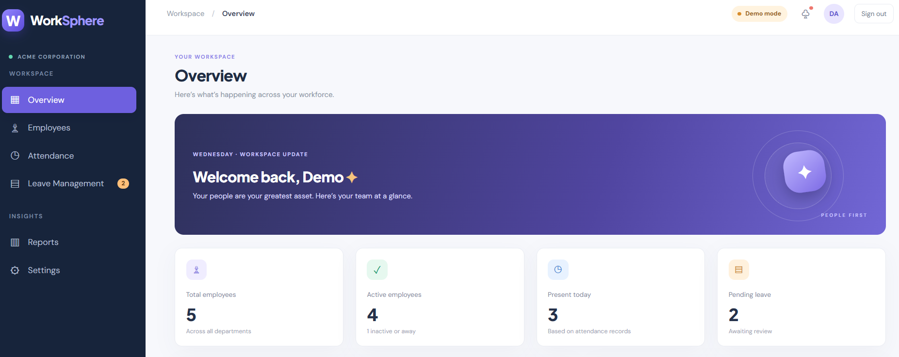
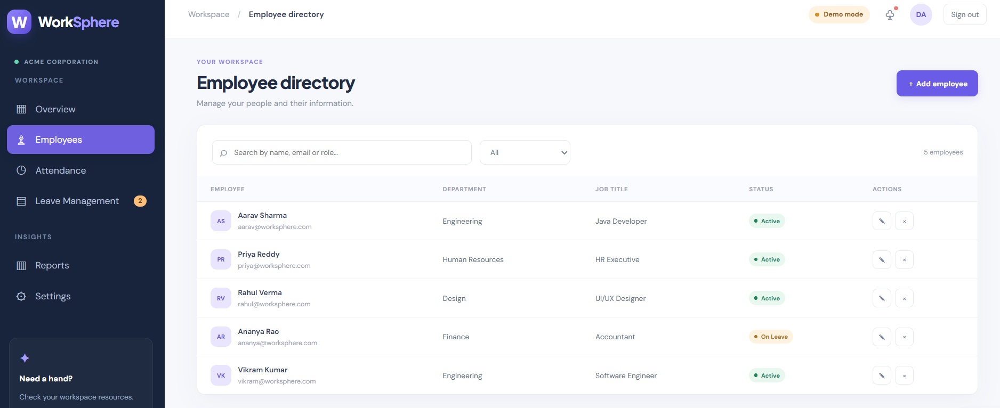
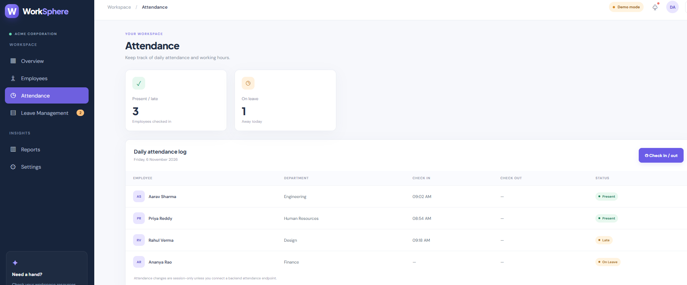
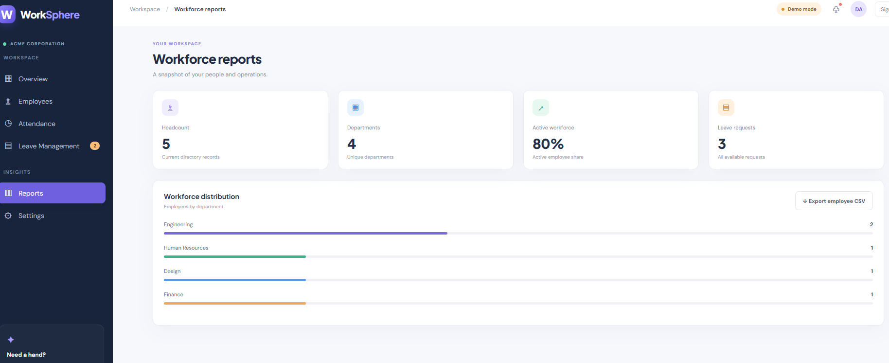
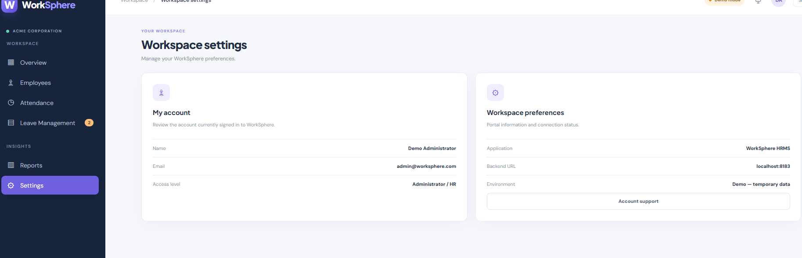

# Employee WorkSphere – Full Stack Employee Management System

Employee WorkSphere is a full-stack web application designed to manage employee-related activities through a centralized interface. It includes modules for employee management, attendance, leave management, reports, and settings.

The application uses **Spring Boot** for the backend, **React.js** for the frontend, and **MySQL** for database management.

## Project Overview

The application follows a client-server architecture:

- **React.js** provides the user interface.
- **Spring Boot** exposes REST APIs to handle application requests.
- **Spring Data JPA / Hibernate** are used for data access and object-relational mapping.
- **MySQL** is used to store application data.

## Technologies Used

| Layer | Technologies |
|---|---|
| Backend | Java, Spring Boot |
| API Development | Spring Web, REST APIs |
| Data Access | Spring Data JPA, Hibernate |
| Database | MySQL |
| Frontend | React.js, JavaScript, HTML5, CSS3 |
| API Communication | Axios |
| Security | Spring Security |
| Build Tool | Maven |
| Version Control | Git, GitHub |

## Backend Architecture

The backend is organized into packages based on their responsibilities.

### 1. Main Application Class

- `EmpportalApplication.java` is the entry point of the Spring Boot application.
- It starts the application using Spring Boot.

### 2. Controller Layer

The controller package contains REST API controllers that handle incoming HTTP requests and return responses.

Controllers include:

- `AdminController.java` – administrative operations.
- `AuthController.java` – authentication-related requests.
- `Employeecontroller.java` – employee-related operations.
- `LeaveController.java` – leave management operations.

**Concepts used:**

- REST API development
- Spring Web annotations
- HTTP request and response handling
- HTTP methods such as GET, POST, PUT, and DELETE, where implemented

### 3. Model / Entity Layer

The model package contains Java classes representing application data:

- `Employee.java`
- `User.java`
- `LeaveReques.java`
- `PasswordResetToken.java`

These classes represent the data structures used by the application and their database mapping.

**Concepts used:**

- Java classes and objects
- JPA entity mapping
- Object-relational mapping (ORM)

### 4. Repository Layer

The repository package contains interfaces responsible for database access:

- `EmployeeRepo.java`
- `UserRepo.java`
- `LeaveRequestRepo.java`
- `PasswordResetTokenRepo.java`

**Concepts used:**

- Spring Data JPA
- Repository pattern
- Database CRUD operations
- Hibernate ORM

### 5. Security Layer

The security package contains security-related configuration and user-details support:

- `SecurityConfig.java`
- `CustomUserDetailsService.java`

This layer configures application security and provides user details to the authentication process.

## Frontend Architecture

The frontend is developed using React.js.

**Main files:**

- `App.js` – main application component and interface.
- `Login.js` – login-related interface.
- `App.css` – application styling.
- `index.js` – React application entry point.
- `index.css` – global styling.

**Frontend concepts used:**

- React functional components
- JSX
- State management using React Hooks
- Component-based development
- Axios for HTTP requests
- API communication with the Spring Boot backend

## Application Modules

1. **Dashboard** – provides an overview of employee-related information and application statistics.
2. **Employee Management** – displays employee information and employee management options.
3. **Attendance Management** – displays attendance information and records.
4. **Leave Management** – displays leave requests and their statuses.
5. **Reports** – provides a section for viewing application information.
6. **Settings** – provides the application settings interface.

## Application Screenshots

### Login Page


### Dashboard


### Employee Management


### Attendance Management


### Leave Management


### Reports


### Settings


## Project Structure

```text
Employee-WorkSphere/
├── backend/
│   ├── src/main/java/com/spring/empportal/
│   │   ├── controller/
│   │   ├── model/
│   │   ├── repo/
│   │   ├── security/
│   │   └── EmpportalApplication.java
│   ├── src/test/
│   └── pom.xml
├── frontend/
│   ├── public/
│   ├── src/
│   │   ├── App.js
│   │   ├── Login.js
│   │   ├── App.css
│   │   └── index.js
│   └── package.json
├── snippets/
│   └── Application screenshots
└── README.md
```

## How to Run the Application

### Prerequisites

- Java JDK
- Maven
- Node.js and npm
- MySQL
- Eclipse IDE or another Java IDE

### Step 1: Clone the Repository

```bash
git clone https://github.com/GandhamSaritha/Employee-WorkSphere.git
```

### Step 2: Configure the Database

- Create the required MySQL database.
- Configure the database URL, username, and password in your local backend `application.properties` file.
- Configure any required email settings using your own credentials.

> The local `application.properties` file is not included in this repository. Create your own configuration file before starting the backend.

### Step 3: Run the Backend

- Open the backend project in Eclipse.
- Allow Maven dependencies to load.
- Run `EmpportalApplication.java` as a Spring Boot application.

Backend URL: `http://localhost:8183`

### Step 4: Run the Frontend

Open a terminal inside the `frontend` directory and run:

```bash
npm install
npm start
```

Frontend URL: `http://localhost:3000`

## Development Note

The screenshots currently show the frontend in **Demo mode**. The demo interface has been tested locally. The live connection between the frontend, Spring Boot backend, and MySQL database should be verified separately before describing it as fully integrated.

## Future Enhancements

- Improve application-wide validation and error handling.
- Add automated unit and integration tests.
- Deploy the frontend and backend.
- Enhance reporting and dashboard capabilities.

## Author

**Saritha**  
Java Full Stack Developer

GitHub: [GandhamSaritha](https://github.com/GandhamSaritha)
